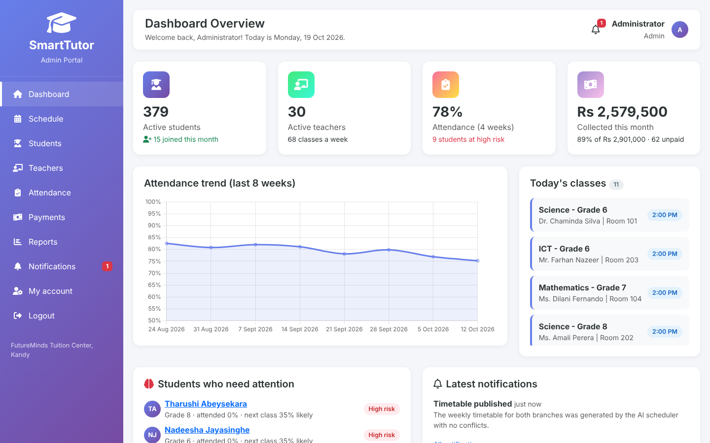
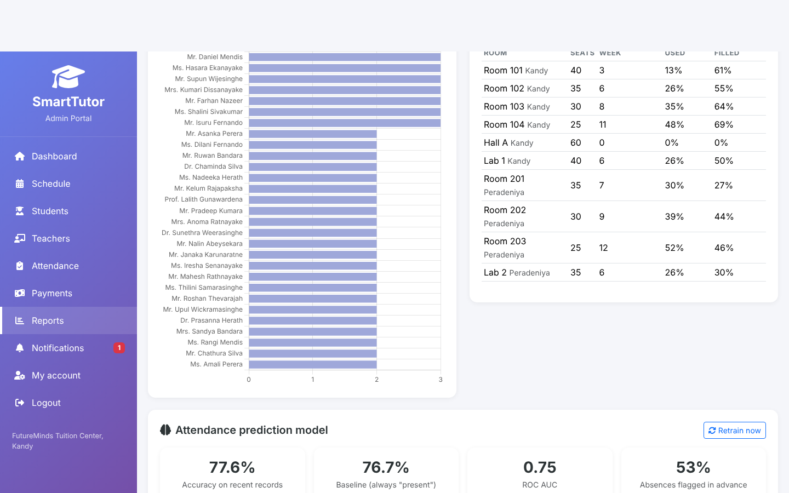
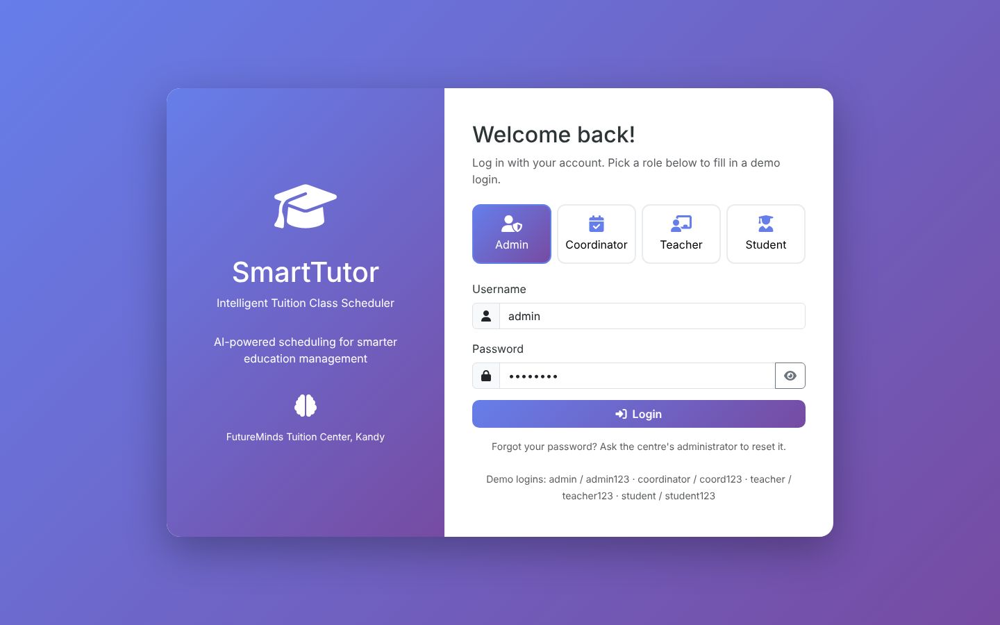
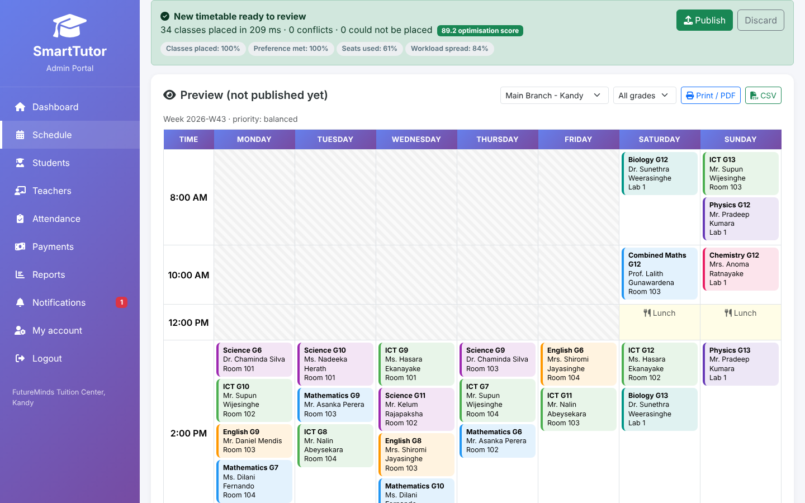
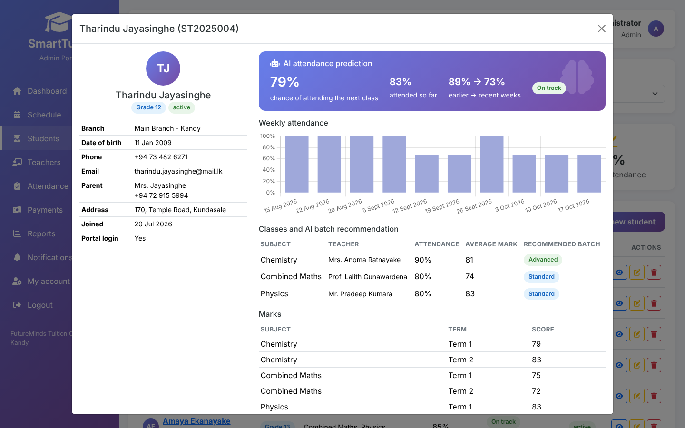
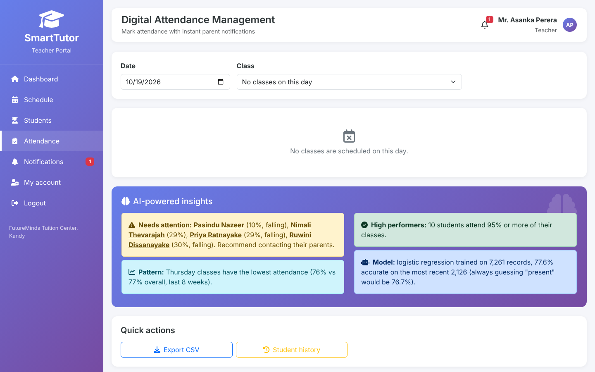
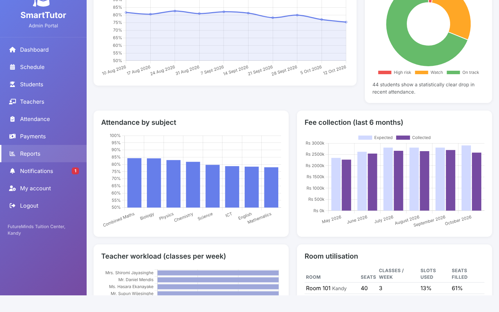
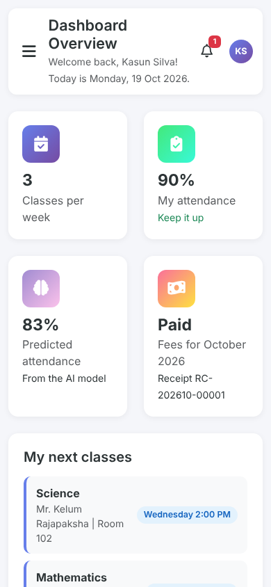

# SmartTutor - Intelligent Tuition Class Scheduler

SmartTutor is a web app for a tuition centre. It builds weekly timetables with a **Prolog constraint solver**, takes digital attendance, and uses **machine learning** to predict which students are likely to miss class. It also handles student and teacher records, fee payments with receipts, and notifications.

It was built for **FutureMinds Tuition Center, Kandy** (2 branches, Grades 6 to 13, about 400 students and 30 teachers) as our final project for the Diploma in Computer Science with Artificial Intelligence at NIBM (DCSAI 25.1).



## Features

| Area | What it does |
|---|---|
| **AI timetable (Prolog)** | Places every class in a day, time and room. It never double-books a teacher, room or grade, respects room capacity, labs and teacher availability, and caps each teacher's classes per day. It can also keep the weekend lunch break free and avoid back-to-back classes for teachers. You can choose what to optimise: balanced, teacher workload, best room fit, or weekday/weekend preference. |
| **Conflict checks and rescheduling** | Every manual move is checked against the same Prolog rules, and you get a plain reason if it is refused. *Reschedule affected classes* keeps everything that is still valid and re-places only the classes that broke, for example after a teacher's availability changes. |
| **Attendance prediction (ML)** | A logistic-regression model trained on the centre's own attendance history predicts each student's chance of attending their next class. It flags at-risk students and declining attendance (checked with a two-proportion z-test), and estimates how many students will turn up to a session. |
| **Batch recommendations (ML)** | k-means clustering on marks and attendance suggests an Advanced, Standard or Support batch for each student in each subject. |
| **Digital attendance** | Teachers mark present, absent or late per session. Absent students get an in-app alert, and an SMS to the parent is queued. |
| **Students and teachers** | Full create, edit and delete for students and teachers, with search, filters and paging. Each student has a profile with a weekly attendance chart, marks entry and fee history. Teachers have subjects, availability and workload, and you can manage classes and assign teachers. |
| **Payments** | Monthly fees worked out from each student's classes. Payments get a printable receipt, there is a list of who has not paid, and you can send one-click reminders. |
| **Reports** | Attendance trends by week, subject and weekday, fee collection, teacher workload, room use, and model accuracy, with CSV exports. |
| **Notifications** | Alerts for timetable changes, absences, payments and availability changes, plus announcements from admins to everyone, teachers or students. |
| **Role-based access** | Admin, Academic Coordinator, Teacher and Student/Parent portals. Each role sees only its own data, and this is enforced on the server. |
| **Responsive** | Works on desktop and mobile, with a slide-in menu on small screens. |

## Quick start

You need **Node.js 20 or newer**. Nothing else needs installing: Prolog runs inside Node as WebAssembly, and SQLite is a single file.

```bash
npm install
npm start
```

Open http://localhost:3000. The first start creates `data/smarttutor.db` with demo data.

| Role | Username | Password |
|---|---|---|
| Admin | `admin` | `admin123` |
| Academic Coordinator | `coordinator` | `coord123` |
| Teacher (Mr. Asanka Perera) | `teacher` | `teacher123` |
| Student / Parent (Kasun Silva) | `student` | `student123` |

Other commands:

```bash
npm test        # 16 automated tests: scheduler rules, ML, API and permissions
npm run seed    # rebuild the demo database from scratch
npm run dev     # restart automatically when files change
```

To use a different port or database file, set `PORT=8080` and `DB_PATH=/path/to/file.db`.

## How the AI works

### Prolog timetable solver ([`src/prolog/scheduler.pl`](src/prolog/scheduler.pl))

The Node server turns the database into Prolog facts (`slot/4`, `room/3`, `available/2`, `class/6`, `setting/2`) and asks for a `plan/4`.

1. **Options.** For each class, the solver lists every (day, time, room) that respects teacher availability, room capacity, lab needs and the lunch break.
2. **Most constrained first.** Classes with the fewest options are placed first.
3. **Cost ordering.** Each option gets a cost based on the chosen priority. The cost counts empty seats, how many classes the teacher and grade already have that day, how busy the day and room are, and whether the day matches the class's weekday or weekend preference.
4. **Forward checking.** The cheapest option is kept only if every class still waiting keeps at least one free option. Otherwise the solver tries the next option.
5. **Validation.** `conflicts/2` re-checks the finished timetable for any teacher, room or grade clash. `move_issues/6` explains why a manual move is not allowed.

The bookings so far are stored as bitmasks, with one bit per weekly slot for each teacher, room and grade. That keeps the clash checks to a few arithmetic steps, and a whole branch is solved in about 0.2 seconds.

> The proposal planned to use Tau Prolog. We built the solver in it first, but it took over a minute per timetable. The same program runs in **SWI-Prolog compiled to WebAssembly** ([swipl-wasm](https://www.npmjs.com/package/swipl-wasm)) more than 300 times faster. It still runs entirely inside Node.js with no extra install, so the "single JavaScript stack" goal from the proposal still holds.

### Attendance prediction ([`src/ml.js`](src/ml.js))

- **Features** for each student before each session: share of the last 5 sessions attended, share of all sessions attended, late-arrival rate, whether the class is on a weekend, and sessions since the last absence.
- **Model:** logistic regression with standardised features and L2 regularisation, trained by gradient descent. It is written from scratch in JavaScript with no ML library.
- **Evaluation:** the split is by time. The model trains on older sessions and is tested on the most recent 20%, so it never sees the future. The Reports page shows accuracy, a baseline that always guesses "present", ROC AUC, and how many absences were flagged in advance. On the demo data the model scores about **78% accuracy against a 76% baseline, with an AUC of about 0.75**. The demo data is generated, so these numbers will change with real data.
- The model retrains automatically shortly after attendance is saved.



## Screenshots

| | |
|---|---|
|  |  |
| **Login with demo roles** | **AI timetable preview with score breakdown** |
|  |  |
| **Student profile with prediction and batch recommendation** | **Teacher marking attendance** |
|  |  |
| **Reports and analytics** | **Student portal on a phone** |

## Tech stack

- **Frontend:** HTML5, CSS3, Bootstrap 5, vanilla JavaScript, Chart.js, Font Awesome. The libraries are served from `node_modules`, so the app works offline.
- **Backend:** Node.js and Express 5, with a REST API under `/api`.
- **Symbolic AI:** SWI-Prolog running as WebAssembly (`swipl-wasm`).
- **Machine learning:** logistic regression and k-means, written in plain JavaScript.
- **Database:** SQLite through `better-sqlite3`.
- **Security:** passwords hashed with scrypt, HTTP-only session cookies, role checks on every endpoint, input validation, parameterised SQL, and a limit on repeated failed logins.

## Project structure

```
server.js                 start-up: open the database, seed demo data, train the model, start Express
src/
  app.js                  Express app and routes
  db.js                   SQLite schema
  seed.js                 demo data generator (deterministic)
  scheduler.js            Node <-> Prolog bridge
  prolog/scheduler.pl     the constraint solver
  timetable.js            loading problems, scoring, saving, rescheduling
  ml.js                   attendance model, risk levels, k-means batches
  auth.js, access.js      sessions and who-can-see-what
  routes/                 REST API: auth, students, teachers/classes, schedule,
                          attendance, payments, reports/dashboard, notifications
public/                   the pages (one HTML file and one JS file per page)
test/                     node:test suites
docs/screenshots/         images used in this README
```

## Notes and limits

- SMS and email to parents are **recorded in an outbox** (Notifications page) rather than sent. Connecting a real SMS gateway would be a small change in `src/notify.js`.
- All names, phone numbers and records in the demo data are made up.
- Sessions live in SQLite. For a real deployment behind HTTPS, set `SECURE_COOKIES=1`.

## Team

Ramindu (DCSAI-25.1-F-032), Gavith (DCSAI-25.1-F-044) and Samitha (DCSAI-25.1-F-022). Diploma in Computer Science with Artificial Intelligence, School of Computing and Engineering, National Institute of Business Management, Sri Lanka.
